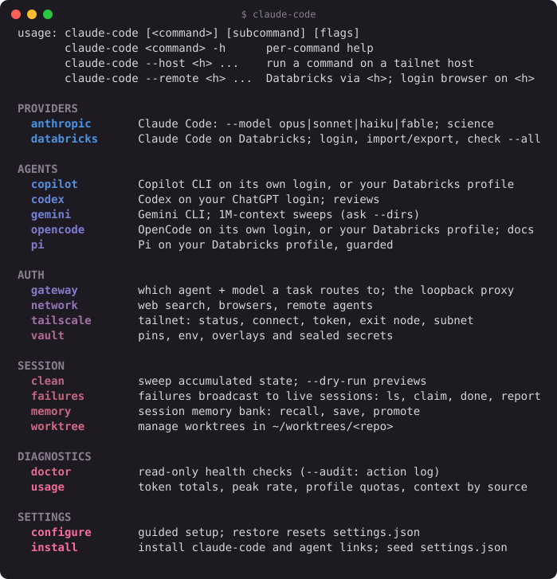

# claude-code

A harness for [Claude Code](https://docs.anthropic.com/en/docs/claude-code). This repository **is** `~/.claude`: one
Go binary, `claude-code`, plus the agents, commands, rules, skills and Workflow scripts every Claude Code session
loads.

What you get on top of a stock install:

- **Providers and a model proxy**: Anthropic, Databricks, OpenAI, GitHub Copilot, Google or a custom endpoint, with
  model aliases per profile and a loopback proxy that translates dialects and fails over on 429/5xx.
- **Agents**: run one-shot tasks on Claude, Codex, Gemini, OpenCode or Copilot (`claude-code agents ask`), or start
  their interactive CLIs through the same registry (`claude-code codex`).
- **Guards**: hooks that stop or ask about destructive commands, leaked secrets and edits to files another agent
  holds (see [Safety](#safety)).
- **Memory and status line**: one memory bank shared by every workspace, and a status line showing provider, model,
  context use and git state.



## Install

Requires macOS or Linux (Windows through WSL), git, make, curl and Go (`make bootstrap` installs Go on a fresh box).

```bash
git clone https://github.com/edotau/claude-code ~/.claude
cd ~/.claude
make install        # builds bin/claude-code, links agent CLIs into bin/, seeds settings.json if it is missing
claude-code doctor  # checks binaries, providers, credentials and the proxy
```

`make install` never overwrites an existing `settings.json`; it only checks it is valid. It installs agent CLIs and
host tools that are missing and never updates one already present, and it runs no root command.
`claude-code install --dry-run` previews all of it. To undo: `claude-code configure --restore` resets `settings.json`
to the template (a backup is written first), and deleting the clone removes the rest. Fresh machine, existing
`~/.claude` and every install option: [`rules/harness/commands.md`](rules/harness/commands.md).

## Five-minute tour

```bash
claude-code configure                 # guided setup; reuses existing logins and prompts only for what is missing
claude-code vault set                 # store a credential in the encrypted vault (guided on a terminal)
claude-code anthropic --model opus    # Claude Code on Anthropic; also sonnet, haiku, fable
claude-code agents list               # which agent CLIs are installed
claude-code agents ask --agent codex "Review this branch."   # one-shot task, read-only unless you add --tools
claude-code memory recall <terms>     # search the memory bank
```

Every verb takes `-h`; `claude-code -h` lists the menu.

## How the pieces fit

| Path | Holds |
| --- | --- |
| `cmd/claude-code/`, `internal/` | The binary; `internal/cli` is the command table, logic lives in each package |
| `internal/settings/hookspec.go`, `internal/hooks/` | Hook declarations and their handlers |
| `agents/`, `commands/`, `workflows/` | Subagents, slash commands, Workflow scripts |
| `rules/`, `skills/` | Standards and gotchas Claude loads; on-demand how-to references |
| `state/vault.db` | The encrypted vault (untracked): secrets, pins, provider and agent overlays |
| `memory/` | The memory bank, a local-only git repo that is never pushed |
| `settings.json` | Yours: hand-edited and untracked |

The full map is `CLAUDE.md` → Where things live. State formats, backups, `container/` and `mods/`:
[`rules/harness/commands.md`](rules/harness/commands.md) → Layout.

## Agents and dispatch

`claude-code agents ask --agent <name> "<task>"` runs a task on another agent CLI and prints an envelope; without
`--tools` the agent is read-only. Batches, retries, remote hosts and reviews: `claude-code agents ask -h` and
[`rules/harness/agent.md`](rules/harness/agent.md). Examples:
[`rules/harness/commands.md`](rules/harness/commands.md) → Agents. In-session fan-out:
[`rules/workflows/master-workflow.md`](rules/workflows/master-workflow.md).

## Providers and credentials

A **provider** hosts an endpoint, a **profile** is an account on it, and a model alias (`opus`, `sonnet`) maps to a
model id per profile. Built-ins are in `internal/providers/defaults.json`; `claude-code switch <profile>` pins the
session profile and `claude-code configure provider --list` shows credential state. **Secrets live only in the
encrypted vault (`claude-code vault set`) or a provider's `auth.command`**, never in a plain file or `settings.json`.
The vault key comes from the OS keyring, `HARNESS_VAULT_KEY` or `key_command`. Commands:
[`rules/harness/providers.md`](rules/harness/providers.md). File shape, credential order, naming, routing and the
Databricks menu sync: [`rules/harness/providers-reference.md`](rules/harness/providers-reference.md).

## Safety

The guards are Claude Code hooks (`internal/hooks/safety/`, `internal/hooks/wthook/`) and a permission layer for the
other agent CLIs (`internal/agent/`). "Main" is the interactive session you drive; a "leaf" is a dispatched agent or
subagent. Per-hook matrix: [`rules/harness/hooks.md`](rules/harness/hooks.md).

| Situation | What happens | Applies to |
| --- | --- | --- |
| `git stash`, `checkout`, `switch`, `reset`, `restore`, `clean` in `~/.claude` | Blocked; make a new commit or use a linked worktree | main and leaves |
| `git commit --amend`, `rebase`, `reset <commit>` that rewrite commits in a shared checkout | Blocked | main and leaves |
| Force push to `main` or `master` | Blocked; push a branch and open a PR | main and leaves |
| `git add` or `commit` of a file another live session or agent has uncommitted edits in | Ask, or block for a leaf under `~/.claude` | main and leaves |
| `claude-code worktree commit` | Commits only the files you name and rolls the index back on failure; a leaf must name its files | main and leaves |
| AI-attribution footer in a commit message | Blocked; `worktree commit` also strips them | main and leaves |
| A command that prints a token piped to `curl`, `nc` or `wget` | Blocked | main and leaves |
| `claude-code vault get --key` (the vault master key) | Ask in main; blocked in a leaf | main, leaves |
| `kubectl` or `oc` `exec`, `delete`, `oc rsh` on a production context | Ask in main; blocked in a leaf | main, leaves |
| `make audit`, `make install`, `make fmt` inside this repository | Blocked for a leaf; `make lint` stays open to all | leaves |
| Read-only agent (no `--tools`) | Only an allow list of read commands runs; writes and redirects are denied | dispatched agents |
| Unsetting or overriding the `HARNESS_DISPATCH_*` variables | Blocked, so a nested dispatch keeps its limits | leaves |
| A relay (an agent that only forwards a task) | May run `claude-code` verbs, read-only commands and `go build\|vet\|test` in listed shapes, never `worktree commit` | relay leaves |
| A leaf writing `settings.json` | Blocked | leaves |

Agent CLIs started through `claude-code <agent>` also lose inherited `*_KEY`, `*_TOKEN` and `*_SECRET` variables.
`claude-code doctor --scan`, `--git` and `--secrets` audit configs and history for leaked credentials.

**What the guards are not.** They read command text, so they catch mistakes and obvious misuse, not a determined
program that hides what it runs. For real isolation use the container image (`container/`) and the vendor sandboxes.

## Design decisions

- **One Go binary on the standard library, no CLI framework**: a framework or per-tool scripts would add install
  steps and dependencies; the command table in `internal/cli` is small enough to read.
- **Hooks declared once in `internal/settings/hookspec.go`**: each agent CLI would otherwise get its own hand-kept
  hook set; one table is rendered into every native format, so all agents get the same guards.
- **Guards are compiled-in code and data, not settings**: a guard stored in `settings.json` could be edited away by
  the agent it limits.
- **One shared checkout with file claims**: a worktree per agent would split state and merges; claims stop two
  writers on one file, and worktrees stay opt-in.
- **`worktree commit` takes named files and restores the index on failure**: `git add -A` and a bare commit sweep up
  peers' edits and can leave a half-staged index.
- **Secrets only in the encrypted vault, injected into the environment at launch**: dotenv files and
  `settings.json` env are plain text that leaks into git and logs.
- **One memory store for every workspace**: a bank per repository fragments what you learned. An index goes into
  the prompt and recall loads the rest on demand.
- **Models by alias, plus GPT family names**: ids go stale. `opus` follows the table, a family name such as `sol`
  resolves to the newest version a provider row serves, and a concrete id pins one.
- **`make fmt` fixes and `make lint` only checks**: a checker that edits files races with parallel agents, so only
  the main session fixes and any agent can lint.
- **Gates fix what is deterministic and fail only when code cannot decide**: a hook that rewrites a known-bad call
  keeps unattended runs moving; a block is for choices that need a person.
- **Tests check behavior through seams and never reach the network** (`internal/nonet`): live calls make tests slow,
  flaky and dependent on credentials.
- **CI is off; `make audit` on a clean tree is the gate before a push**: it runs the same checks locally at no cost.

## Development

```bash
go test ./internal/<pkg>   # while developing: only the package you touched
make lint                  # checks only, writes nothing; any agent may run it
make fmt                   # fixes go, yaml, markdown and memory banks; main session only
make test                  # the full test suite
make audit                 # full local gate on a clean tree; run before every push (main session)
```

`git push` runs no gate and CI is off. `settings.json` is yours; see
[`rules/harness/settings-management.md`](rules/harness/settings-management.md). `make help` lists every target.

## License

MIT, see [`LICENSE`](LICENSE).
