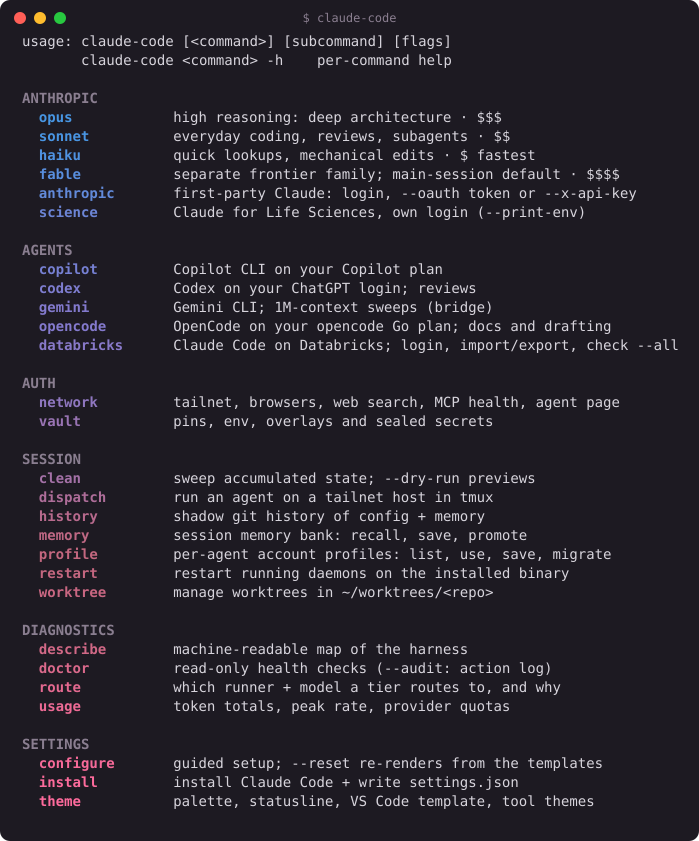

# claude-code

A minimal harness for [Claude Code](https://docs.anthropic.com/en/docs/claude-code). This repo **is** `~/.claude`:
one Go binary, `claude-code`, plus the agents, commands, rules, skills and Workflow scripts every session loads.

What it adds to a stock install:

- **Provider registry** — Anthropic (Claude login or API key), Databricks, OpenAI (ChatGPT login or API key),
  GitHub Copilot, Google (Antigravity), NVIDIA or any custom endpoint; model aliases (opus/sonnet/haiku/fable) map to
  model ids per profile.
- **Loopback proxy** — OpenAI-dialect translation, per-model-alias provider mixing, failover on 429/5xx.
- **Agents** — one-shot tasks on Claude, Codex, Gemini, OpenCode or Copilot (`ask`), or their interactive CLIs
  (`claude-code <agent>`).
- **Hooks, memory, status line** — a Bash safety gate, a per-repo memory bank, format-on-stop, context checkpoint.

Every verb takes `--help`; `claude-code describe` maps the whole harness.

## Install

```bash
git clone https://github.com/edotau/claude-code ~/.claude
cd ~/.claude
make install                  # build, link agent CLIs into bin/, render settings.json, add linters (DEV_TOOLS=0 skips)
claude-code doctor            # check binaries, providers, credentials, proxy
```

- `make bootstrap` — fresh box: Go toolchain (no sudo), install, bash completion, then `claude-code configure`
  (`CHECK=1` runs `configure --check` instead; `TAILSCALE=1` adds tailscale).
- `claude-code install --dry-run` previews; foreign hooks in `settings.json` are kept, with a timestamped backup.
- A missing agent CLI is reported, never downloaded; `install --tools=<name>` installs it.
- `bin/<agent>` is the real, unrouted CLI. Routed launches go through `claude-code <agent>`.



```bash
claude-code opus        # Claude Code with opus as the main model (also sonnet | haiku | fable)
claude-code codex       # an agent CLI through the registry (also gemini | opencode | copilot)
claude-code qa          # Claude Code on that registry profile
claude-code --resume    # a leading flag passes to claude, on the session provider
```

## Setup

```bash
claude-code configure                 # interactive menu: providers, logins/keys, models, agents; Submit seals keys
claude-code configure models          # one page (provider|models|agents|router|github|remote|browser|claude|codex|routing|databricks|doctor)
claude-code configure claude          # per-machine settings overrides; team defaults stay in the template
claude-code configure codex           # vault-backed reasoning effort and output verbosity
claude-code configure --check         # report only; exit 1 if anything is unset
claude-code configure --reset [--out f|--check|--dry-run]   # render settings + agent CLI configs
claude-code configure --restore [--agent a,b]       # restore agent CLI configs from backup
claude-code theme vscode [--check|--dry-run]             # merge VS Code settings + keybindings
```

- `configure` reuses what already exists (env, vault, agent CLI logins) and prompts only for what is missing.
- **Claude subscription** keeps Remote Control; **API key** pays per token. For headless runs on a Max plan,
  `configure` mints `claude setup-token` into the vault as `CLAUDE_CODE_OAUTH_TOKEN`.
- Agent CLI configs are merged, never replaced: `~/.codex/config.toml`, `~/.gemini/antigravity-cli/settings.json`,
  Codex/Copilot hooks. Keys are referenced by env var, exported only by a routed launch. opencode's own
  `~/.config/opencode/` is never written (its model/MCP/theme come from a tracked overlay, `OPENCODE_CONFIG` /
  `OPENCODE_TUI_CONFIG`, injected at launch — `internal/vendors/template/`).
- On a terminal, `configure --reset` prompts before overwriting hand-edited lines it would otherwise lose; a
  non-interactive run (launch, `configure`, `make install`) writes and warns instead. Each overwrite keeps 5
  timestamped backups; `configure --restore` steps an agent CLI file back one version at a time.
- Codex preferences are saved in the vault and applied to `$CODEX_HOME/config.toml` (default
  `~/.codex/config.toml`). Its config snapshots and comparison baseline are encrypted in the vault instead of
  written as plaintext backups. The last five snapshots per config path are kept;
  `configure --restore --agent codex` restores the preceding version and its managed preferences.
  Provider configuration, hook trust, and unknown native settings are preserved. Check and dry-run do not write.
  An unavailable vault key aborts changed Codex writes.
- From a worktree, render only that checkout:
  `CLAUDE_CONFIG_DIR="$PWD" claude-code configure --reset --out "$PWD/settings.json"`
  (agent CLI homes are skipped unless `--agents`).

### Setup modes: adopt, nuke, workspace

```bash
git clone https://github.com/edotau/claude-code ~/.claude.stage      # ~/.claude already exists: stage the clone,
make -C ~/.claude.stage adopt                                         # then adopt it (backs up collisions) + bootstrap
claude-code install --setup nuke [--apply] [--keep-memory]            # archive untracked content, then remove
claude-code install --setup workspace init|link|status                # scope a project's own .claude/
```

## Providers

Built-ins live in `internal/providers/defaults.json`. `claude-code vault edit` overlays them **by name** (an entry
replaces the built-in; `null` removes it). Each entry is a **profile** (an account on a provider: `qa`,
`max`, `chatgpt`); see [Naming](#naming).

```jsonc
"providers": {
  "default": "example",
  "fallback": ["example", "anthropic"],         // 429/5xx ladder (implies the proxy)
  "providers": {
    "example": {
      "protocol": "anthropic",                       // protocol base_url speaks
      "base_url": "https://llm.example.com",
      "routes": {"openai": "/v1"},               // extra protocols on the same endpoint
      "auth": {"type": "key", "env": "EXAMPLE_API_KEY"},
      "models": {"opus": "claude-opus-5", "sonnet": "claude-sonnet-5", "haiku": "gpt-5-nano"}
    },
    "ollama": null
  }
}
```

| Field | Meaning |
| --- | --- |
| `protocol` | `anthropic` · `openai` · `responses` · `gemini` |
| `auth.type` | `oauth` · `m2m` · `pat` · `key` · `cli` (the agent's own login; `auth.login` names the CLI) · `none`; optional `auth.header` |
| `models` | model alias → model id |
| `headers` | sent on every upstream request |

```bash
claude-code configure provider --list [name]        # providers, credential state, fallback ladder
claude-code configure provider --all [<profile>]    # check every sign-in (or one); offers login on a terminal
                                                    # --check exits 1 if any not ok
claude-code switch example                          # pin the session profile
claude-code models --pin haiku=openai:gpt-5-nano    # pin a model alias; provider:model crosses providers
claude-code models --unpin | --live --profile p     # clear pins | list what upstream serves
claude-code --profile example --model sonnet         # this launch only
```

Precedence: `--profile` → vault pin `CLAUDE_PROFILE` → registry `default`. Model: `--model` → `CLAUDE_<TIER>_MODEL` →
`CLAUDE_MODEL` → the profile's `models`. Process env beats vault pins.

### Vault: `claude-code vault list|edit`

`state/vault.db` holds pins, custom launch env, provider/agent overlays (`providers`, `agents`) and `key_command` as
one JSON document, plus sealed secrets. `vault edit` opens it in `$EDITOR` and saves atomically; secrets never appear
in it.

Codex's validated preferences use the `codex-settings` overlay. Full config backups use a separate encrypted
`settings_backups` collection: they rotate with the vault key and are excluded from credential exports.

`vault list` hides empty sections (`--format json` keeps all), shows secrets as `<prefix>***  N chars`, caps column
widths and marks failing entries with ✗ first.

```jsonc
{
  "pins": {"CLAUDE_PROFILE": "max", "CLAUDE_HAIKU_MODEL": "openai:gpt-5-nano"},
  "env": {"MY_PROJECT_ROOT": "/home/me/work", "SOME_API_TOKEN": "@secret"},   // @secret = vault secret of that name
  "providers": {"default": "example"},
  "agents": {"agents": {"codex": {"permission": {"approvalPolicy": "on-failure"}}}},
  "vault": {"key_command": ""}
}
```

## Credentials

First non-empty source wins:

1. **Process env** — `auth.env`
2. **Vault** — `claude-code vault set <KEY>` (AES-256-GCM)
3. **`auth.file`**
4. **`auth.command`** — prints the credential; cached `auth.ttl` seconds (default 300), re-run on 401

```json
"auth": {"type": "key", "command": "op read op://Private/example/credential", "ttl": 3600}
```

`claude-code token --profile <p>` is the `apiKeyHelper` Claude Code calls, so no key lands in `settings.json`.

```bash
claude-code vault set [KEY]            # bare on a terminal = guided dialog
claude-code vault get KEY... [--export]
claude-code vault import keys.env      # then delete the plaintext file
claude-code vault get KEY... | ssh box claude-code vault import - --yes
claude-code configure provider --list  # credential sources; never prints values
claude-code doctor --scan|--git|--secrets   # leak audits; never print values
```

Databricks: an `oauth` profile seals its refresh and access tokens together (`DATABRICKS_<PROFILE>_OAUTH`); `pat` is
sealed too. `m2m` tokens are minted per use and never stored; the service-principal secret stays sealed
(`DATABRICKS_<PROFILE>_M2M`).

`claude-code databricks mint [--profile <id>] [--copy] [--clear-after 30s] [--dry-run]` prints the auth type, length and
expiry, never the token. `--copy` puts it on the clipboard and clears it after 30s; on WSL the copy stays out of Win+V
history.

`claude-code configure` → databricks: Login / Paste PAT / Mint now / Copy token / Apply to agents.
`configure databricks --check` gives the same information without the TUI.

`claude-code databricks check --1m [--profile qa]` passes only when the endpoint reports real `input_tokens` > 200k,
printing `1m PASS (input_tokens=N)`. It writes no config; 1M is the base behavior on serving and first-party endpoints.

Clipboard gaps: macOS clipboard managers and Universal Clipboard can keep a copy; a killed clear process leaves the
token; headless Linux has no clipboard.

### The vault key

32 random bytes, resolved in order: `HARNESS_VAULT_KEY` → OS keyring (service `claude-code`) → `key_command` (a JSON
argv run without a shell). No key file is written. Headless boxes set `HARNESS_VAULT_KEY` or `key_command`.
`HARNESS_VAULT_KEY` is scrubbed from agent CLI children. `vault rotate-secret` re-seals and keeps old keys.

## Naming

| Term | Means | Values |
| --- | --- | --- |
| agent | the CLI doing the work | `claude` `codex` `copilot` `opencode` `gemini` |
| provider | the platform hosting the endpoint | `anthropic` `databricks` `github` `openai` `google` `nvidia` |
| profile | an account on a provider; carries billing | unique across all providers, `[a-z0-9-]`, opaque to code |
| auth | how a profile proves who it is | `oauth` `m2m` `pat` `key` `cli` `none` |
| model | what `--model` takes | an alias (`opus`, follows the table), a version (`opus-5-5`, pinned) or a full wire id |
| proxy · router | the loopback daemon · the agent + model pick | `gateway proxy` · `gateway router` |
| wire | the protocol a model rides on a profile, one rule (`providers.WireFor`): Claude → `anthropic`, Responses-only → `responses`, else `openai`; a profile without that route does not serve the model | `anthropic` `openai` `responses` |

`oauth` = a user login whose token the harness holds; `m2m` = a service-principal secret; `pat` = personal access
token; `key` = API key; `cli` = the agent's own CLI verified the user (an optional headless token may be sealed);
`none` = no credential. Retired words: runner and vendor (→ agent), router for the daemon (→ proxy), slot and tier
(→ model alias), leg (→ dispatch), family (→ provider). `gateway` names the verb namespace only; the Databricks wire
is `ai-gateway`.

| Surface | Form | Example |
| --- | --- | --- |
| Label (display) | `<agent> → <provider>·<profile>/<model>` | `copilot → databricks·dev/databricks-claude-opus-5-5` |
| Flags | `--profile <profile>` · `--model <tier\|version\|wire id>` | `--profile dev --model opus` |
| Pins (vault only) | `<AGENT>_<FIELD>` | `CLAUDE_PROFILE`, `CLAUDE_OPUS_MODEL`, `COPILOT_PROFILE`, `GEMINI_MODEL` |
| Registry | profiles nested under their provider | `providers: {databricks: {qa: {…}}, anthropic: {max: {…}}}` |
| Vault secret | the tree path flattened, stopping at auth; a profile named after its provider is written once | `DATABRICKS_PROD_OAUTH`, `ANTHROPIC_KEY` |
| Route account key | `<provider>·<profile>` | `anthropic·max` |
| Header | optional `auth.header` (`x-api-key` \| `bearer`); defaults from the protocol | — |

Rules: one vault entry per profile (an `oauth` entry seals `{refresh, access}` together); pins are read from the vault,
never from inherited env; vendor-read env (`ANTHROPIC_*`, `CLAUDE_CODE_*`, `COPILOT_*`) is never renamed, only
exported at launch; model ids are built per provider from the canonical form (`opus-5-5` → `claude-opus-5-5`,
`databricks-claude-opus-5-5`, `system.ai.claude-opus-5-5`, `claude-opus-5.5`); code never parses a profile name, so
renaming one moves its row and re-seals its vault entry, nothing else.

| Provider | Profile | Auth | Vault entry |
| --- | --- | --- | --- |
| anthropic | `max` · `anthropic` | `cli` · `key` | `ANTHROPIC_MAX_OAUTH` (optional; exports `CLAUDE_CODE_OAUTH_TOKEN`) · `ANTHROPIC_KEY` |
| databricks | `dev`, `qa`, `prod` · service principals (named later) | `oauth` · `m2m` | `DATABRICKS_<PROFILE>_OAUTH` · `DATABRICKS_<PROFILE>_M2M` |
| github | `personal`, `work` (login is a row field) | `oauth` | `GITHUB_PERSONAL_OAUTH` (exports `COPILOT_GITHUB_TOKEN`) |
| openai | `chatgpt` · `openai` | `cli` · `key` | none · `OPENAI_KEY` |
| google | `antigravity` | `cli` | none |
| nvidia | `nvidia` | `key` | `NVIDIA_KEY` |

opencode's go/zen accounts stay outside the tree for now (`OPENCODE_API_KEY`).

Status line: a minted-token countdown reads `<auth>:42m` (`oauth:42m`); the token count reads `total:1.23M` (main
session plus every finished dispatch, 2-3 significant figures, a trailing `+` while dispatches still run).

## Routing

`claude` launches **direct** when the provider speaks `anthropic`, every model alias stays on it, and no `fallback` is
set. Otherwise it goes through the **loopback proxy** (`127.0.0.1:18765`, started on demand), which:

1. requires a per-install client secret and a loopback `Host`;
2. resolves `model` (`id` or `provider:model`) and strips `[1m]`;
3. passes `anthropic` routes through; translates Messages ⇄ chat-completions for `openai` routes (streaming, tools);
4. refreshes the credential and replays once on 401/403;
5. fails over along `fallback` on 429/5xx/connect error before the first byte;
6. on a hard-quota 429 demotes opus → sonnet → haiku and skips the dead model for 30 minutes;
7. an upstream 400 `prompt is too long` is not retried or failed over: it returns a clean `invalid_request_error` with
   the limit text.

Provider hostnames resolving into the local network are refused (a literal IP or `localhost` in `base_url` is allowed).
The proxy disables Remote Control, so a subscription session stays direct under a `fallback` ladder; a
cross-provider model alias still sends it through the proxy.

- The client secret is sealed in the vault (`CLAUDE_CODE_ROUTER_SECRET`); the first run imports and deletes a legacy
  `state/router.secret`. `claude-code resolve --proxy` prints it.
- Upstream requests carry `User-Agent: claude-code/<version> <agent>`. `HARNESS_REQUEST_TAGS` (a single-line JSON
  object of strings, ≤ 4 KiB) goes out as `Databricks-Ai-Gateway-Request-Tags` on AI Gateway rows only.
- A 401 names the remedy for the row's auth type: `databricks login`, its `auth.command`, `vault set <env>`, or
  `configure provider --list <name>`.

```bash
claude-code gateway proxy [--start|--stop|--status]   # bare = --status
claude-code gateway proxy --serve --port 18765        # foreground
claude-code gateway router [--model M] [--task "<text>"]   # agent + model pick
```

## Tailscale

```bash
claude-code network tailscale [--machines|--connect|--key [--save]|--exit-node on|off|approve]
```

`status`/`machines`/`connect` use the installed CLI. `key` and `exit-node --approve` need
`TAILSCALE_OAUTH_CLIENT_ID`/`_SECRET` (preferred) or `TAILSCALE_API_KEY` in the vault. `make tailscale-cli` installs it.

`claude-code network vscode [--port N] [--stop] [--status] [--no-tailscale] [--funnel]` runs
`code serve-web` as a detached daemon and maps it onto the tailnet (or the public internet with
`--funnel`), printing a token-gated URL and a terminal QR code for your phone.

## Worktrees and agent views

```bash
claude-code worktree list|create <name>|clean <name>|clean-all   # ~/worktrees/<repo>/*; never forces a removal
claude-code agents tree [--watch]          # sessions → subagents → workflows, with agent dispatches and fallbacks
claude-code agents tree --running          # only what runs now, machine-wide: sessions, subagents, dispatch jobs
claude-code agents reap [--dry-run]        # mark lost dispatch jobs `error`, drop dead agent-inflight markers
claude-code network view <agentId> [--follow]  # one agent's snapshot or live events
claude-code network page [--addr ip:port]           # dashboard over loopback or the tailnet
claude-code dispatch --host <h> --agent <a> "<task>"   # detached agent TUI on another box (tmux)
claude-code network browser [--setup --browser edge]      # browser control paths; Claude in Chrome install
claude-code network websearch --query q           # Tavily one-shot (bare = stdio MCP server)
```

## Agents

```bash
claude-code agents                                     # agents and availability
claude-code ask --agent codex "Review this branch."    # one-shot; --format json, --tools, --effort
claude-code ask --log | --retry <id>                   # recent dispatches; replay one
claude-code opencode --profile ollama --model qwen3-coder   # interactive; -- forces passthrough
claude-code codex catalog                             # the agent's model catalog; also copilot|gemini|opencode
claude-code opencode catalog list|add|remove|import|reset|check   # inspect, edit or probe the model menu
claude-code codex review --adversarial --base main     # per-agent verbs; claude-code codex -h lists them
claude-code gemini bridge --dirs internal "<task>"     # one 1M-context sweep via agy
claude-code agents sync [--dry-run|--check]            # project agents/ + CLAUDE.md into every agent CLI
claude-code usage --days 7                             # subagent token usage; copilot on BYOK = databricks/<model>
```

- `catalog` lists an agent's model catalog; `--model` selects the model for this launch. The agent subcommand
  `models` remains a compatibility alias for `catalog`; top-level `claude-code models` is unchanged.
- `ask --format json` prints one envelope: `agent`, `status` (`ok|error|partial|quota|stalled`), `model`, `answer`,
  `usage`, `duration_ms`, `fallback*`, `handoff` and `transport` (attempts, retries, first-event and max-gap ms).
  Claude-only isolation flags: `--no-persist`, `--safe-mode`, `--debug-file <path>`.
- `opencode` on a Databricks row runs three providers: `<row>` (chat), `<row>-gpt` (Responses) and `<row>-claude`
  (native Anthropic); a `--model` not on the row's menu is refused. An `ai-gateway` row has no openai route, so its
  chat models (and the copilot registry's) are left out with a one-line note.
- Claude Code on a Responses-only model (`gpt-5.5`) is refused at launch and by the router: it has no Responses
  translation; use `codex` or `copilot`.
- Copilot dispatches follow the session's profile through the proxy (`/p/<profile>`, BYOK, `COPILOT_OFFLINE=true`, no
  Copilot credits); `--model <profile>:<tier>` picks a model alias on another profile. The GitHub login is used only
  when the `COPILOT_PROFILE` pin has credits verified < 95%; else it falls back to the Databricks profile (never
  the other GitHub account) and prints `copilot: <user> N% of credits used — using databricks profile <p>`. Usage rows
  read `databricks/<model>` (BYOK, no credits) vs `github·copilot/<model>`. Prompt cap = window − 32k − 10%.
- Interactive `copilot` on a Databricks profile has native `/model` across the profile's served models: a per-launch
  registry (0600, per pid) and a private login-free `COPILOT_HOME` (`state/copilot/registry-home`); the proxy takes a
  session token, so no secret sits on disk. An unregistered model fails closed; `--direct` keeps the single-model
  route. macOS is refused until the Keychain check lands (use `--direct`). `ask --agent copilot` uses the same
  registry via the SDK.
- Without `--tools`, agents are read-only. Gemini runs only on `agy` and its Google sign-in.
- `gemini bridge` inlines tracked files only and always skips `.env*`, `state/`, keys.
- `agents sync` renders under `state/projections/<agent>/`, installs into `~/.codex`, `~/.copilot`, `~/.gemini`,
  `~/.config/opencode`, and links `skills/` into `~/.agents/skills`. No AGENTS.md lives at this root (Claude Code would
  load it as a second CLAUDE.md).
- In-session fan-out: `agents/` subagents and `workflows/` scripts — see `rules/workflow/master-workflow.md`.

## Hooks

Declared in `internal/hookspec/hookspec.go`, implemented in `internal/hooks/`. To add one: implement, register a
`Spec`, `make install`.

| Hook | Event | Does |
| --- | --- | --- |
| `bash-guard` | PreToolUse Bash | Blocks destructive commands (`rm -rf /`, force-push main, `curl \| sh`, git resets in `~/.claude`); routes noisy output through rtk |
| `docs-placement` | PreToolUse Write/Edit | Blocks new `.md` at a repo root or ignored `docs/`; enforces the plan template |
| `agent-effort` | PreToolUse Agent | Fills an unset subagent model (low → haiku, else sonnet); appends up to 3 memory recall pointers to the spawn prompt |
| `workflow-lint` | PreToolUse Workflow | Pins unpinned inline agents to sonnet |
| `agent-inflight*` | Pre/PostToolUse Agent | Caps concurrent dispatches at 24 |
| `subagent-stop` | SubagentStop | Retires the stopping subagent's inflight entry |
| `plan-mirror` / `save-plan` | PostToolUse | Dated plan copies under `plans/`; files the approved plan |
| `stop` | Stop | At ≥85% context, pauses once for a handoff; then saves the session to memory and formats files edited this turn |
| `session-start` | SessionStart | Injects the memory catalog and this repo's active context |
| `memory-recall` | UserPromptSubmit | Injects up to 3 matching memory blocks |
| `wsl-path-normalize` | UserPromptSubmit | Maps pasted Windows paths to `/mnt/…` |
| `session-harvest[-end]` / `pre-compact` | Stop / SessionEnd / PreCompact | Saves the session into the memory bank |
| `access-trace` | PostToolUse Read | Logs bank reads for `memory review` |
| `worktree-create` / `-remove` | Worktree* | Under `~/worktrees/<repo>/`; refuses dirty removals |

Hook commands rendered into `~/.codex` carry a `HARNESS_HOOK_AGENT=codex` prefix; any `HARNESS_HOOK_*` prefix counts as
harness-owned on re-render.

## Memory bank

One store, `~/.claude/memory/`: a local-only git repo (every settle commits, never pushed).

```text
memory/
  index.md       generated catalog — never hand-edit
  home/          cross-repo bank
  claude-code/   the harness's own bank
  <repo>/        per repo, keyed by origin remote basename; .origin records identity
```

Each bank dir holds Claude Code's native memory (`MEMORY.md` + topic files) and six typed files: `projectContext`,
`activeContext`, `progress`, `decisionLog`, `conventions`, `sessionHistory`. `MEMORY.md`'s
`<!-- bank:begin -->…<!-- bank:end -->` region is generated; lines outside it are never touched.
`~/.claude/projects/<slug>/memory` is a symlink into the store.

A session gets the catalog plus this repo's active context and progress; the rest loads on demand. Settles rotate
`sessionHistory` past 30 entries into `archive/`. `memory dream` consolidates daily in the background.

```bash
claude-code memory recall [--repo R|--all] <terms>    # BM25 search; public verb
claude-code memory init|review|promote|remember|update|dream   # public verbs
claude-code memory path|index|show <id>|digest|timeline|fmt|watch   # private plumbing
claude-code memory archive [--split N --apply|--dupes]  # keep MEMORY.md small
claude-code memory alias                             # fold a second checkout
```

`claude-code memory init` enriches a bank; `claude-code memory update` saves manually.

## Housekeeping

```bash
claude-code clean [--list|--dry-run] [--target projections|sessions]   # sweep caches, run dirs, backups
claude-code history snapshot|log|diff     # shadow history of config (never secrets)
claude-code doctor --audit [--days 7]     # provider switches, pins, secret sets, guard blocks, failovers
claude-code network mcp                    # MCP health, scope drift, inline secrets
claude-code theme [--preview] | apply     # statusline palette; whole look across tools
```

## Status line

`claude-code theme statusline [--style gradient|powerline|capsule|minimal|dashboard]` shows
`<provider>·<profile> · <model>` (provider before model), context % and git state, plus either the 5h/weekly rate
limits (`5h:N% 7d:N%`) or, on a profile whose token the harness mints, its time left (`tok:42m`). Off by default and
enabled under `segments`: `router` (proxy state), `tokens` (`~46k tok`, this session's count), `duration`, `session`,
and `agents` (`N ◉` agents running: main thread + subagents + this session's dispatches). `gradientEase` (<1) reaches
the ramp's end sooner.
Config: `~/.claude/state/statusline/config.json`.

## Layout

```text
cmd/claude-code/     main
internal/            cli (verb table) · providers · proxy · router · translate · launch · vendors · agent · hooks · memory …
agents/ commands/ rules/ skills/ workflows/   loaded by Claude Code
state/vault.db       pins, env, overlays, sealed secrets (untracked)
memory/              the memory store (its own local git repo)
plans/               implementation plans (untracked)
docs/templates/      index of every embedded (`//go:embed`) template, with rendered examples
```

## Command reference

Rows `CLAUDE.md` points here for.

| To… | Run |
| --- | --- |
| Set up a box end to end | `claude-code configure [section] [--agent a] [--check]` · `make bootstrap` |
| Adopt, wipe or scope a `.claude/` | `claude-code install --setup adopt\|nuke\|workspace` |
| Sync VS Code settings | `claude-code theme vscode [--check\|--dry-run]` |
| Bash tab completion | `claude-code completion --install` |
| Add a custom endpoint | `claude-code vault edit` → `providers.providers` |
| Edit pins, env, overlays | `claude-code vault list\|edit\|rotate-secret` |
| OpenCode reasoning effort | TUI `ctrl+t` · `opencode run --variant high` · `claude-code ask --effort high` |
| Project agents into every agent CLI | `claude-code agents sync [--vendor v] [--dry-run\|--check]` |
| Run an agent on another tailnet box | `claude-code dispatch --host <h> --agent <a> "<task>"` · `--list --status` |
| Watch agents from a phone | `claude-code network page [--addr ip:port]` |
| Subagent status and dispatches | `claude-code agents tree [--watch\|--running]` · `agents reap` · `claude-code network view <id>` |
| Browsers Claude in Chrome can drive | `claude-code network browser` · `network browser --setup --browser <b>` |
| Audit what acted | `claude-code doctor --audit` |
| Config history | `claude-code history snapshot\|log\|diff` · memory: `git -C ~/.claude/memory log` |
| Theme | `claude-code theme [--preview] [<palette>]` · `theme apply` |
| Keep MEMORY.md small | `claude-code memory archive [--split 20 --apply]` |
| Lint a workflow script | `claude-code workflow lint` · `workflow skeleton <pattern>` |
| Tailnet | `claude-code network tailscale [--machines\|--connect\|--key\|--exit-node on\|off\|approve]` |
| VS Code on your phone | `claude-code network vscode [--stop\|--status] [--funnel]` |

## Development

```bash
go test ./internal/<pkg>   # while developing — only what you touched
make lint                  # fmt, vet, shell, yaml, markdown (CHECK=1 reports only)
make lint-deep             # golangci-lint, uncapped
make test                  # full gate, once before pushing (= make audit = CI)
```

- `git push` runs the same gate via `.githooks/pre-push`; `--no-verify` bypasses it.
- `settings.json` is generated: edit `internal/settings/template/`, then `make install`. Template keys reset
  on every install; permission lists are unioned, so a removed rule must also be deleted from `settings.json` by hand.
