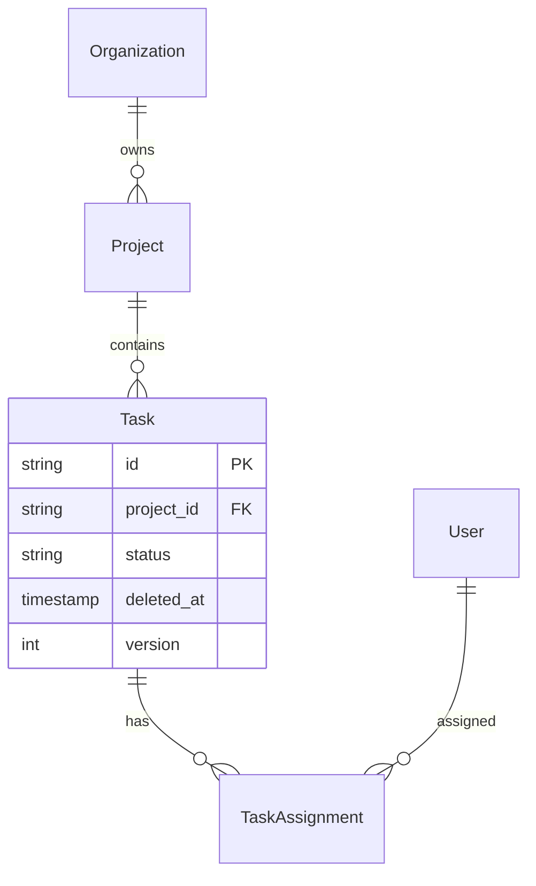

# Schema Design

Turn requirements into a normalized relational schema with the cross-cutting concerns baked in.
Grounded in one reference stack: Django models over Postgres (portal) and Databricks/Unity
Catalog Delta tables (pipeline). Stack-agnostic principles first, then one concrete Django example.

## Requirements → entities → relationships

1. **Extract entities** from the requirement's nouns. "Users create projects; projects have
   tasks; tasks can have labels and be assigned to users; we need an audit trail" →
   `User, Project, Task, Label, TaskLabel (junction), TaskAssignment, AuditLog`.
2. **Map relationships** — 1─* (FK on the many side), *─* (junction table with a composite unique).
   `User 1─* Project`, `Project 1─* Task`, `Task *─* Label via TaskLabel`, `Task *─* User via TaskAssignment`.
3. **Normalize to 3NF** by default — every non-key column depends on the key, the whole key, and
   nothing but the key. Denormalize only for a measured read-path win, and document why.

## Cross-cutting concerns — add to every tenant-scoped table

- **Multi-tenancy** — `organization_id` FK on all tenant data. Enforce isolation in the DB (RLS
  below), not just app code.
- **Soft delete** — `deleted_at TIMESTAMPTZ NULL` instead of `DELETE` for auditable data; filter
  `WHERE deleted_at IS NULL` (and index it — see below).
- **Audit trail** — `created_at`, `updated_at`, `created_by_id`, `updated_by_id` everywhere; a
  separate `AuditLog` (before/after JSON) for regulated/compliance domains.
- **Optimistic locking** — `version INTEGER` bumped on write; reject stale updates (concurrent
  writes silently overwriting each other is a classic data-loss bug).
- **Keys** — UUID/CUID surrogate PKs, never a mutable natural key (email, slug) and never expose
  sequential integer IDs (row-count leakage).

## Index strategy

- **Index every foreign key** — unindexed FKs make joins and cascade checks scan.
- **Composite indexes match the query** — `WHERE org_id = ? AND status = ?` needs
  `(org_id, status)` in that column order (leftmost-prefix rule).
- **Partial indexes for soft delete** — `CREATE INDEX ... WHERE deleted_at IS NULL` so the
  active-row queries stay cheap and the index stays small.
- **Covering indexes** for hot read paths — include the selected columns to avoid a heap fetch.

## Row-Level Security (Postgres — real, tested)

Enforce tenancy in the database so a bug in app code can't leak across orgs.

```sql
ALTER TABLE tasks ENABLE ROW LEVEL SECURITY;
CREATE ROLE app_user;

-- Only tasks in the caller's organization's projects
CREATE POLICY tasks_org_isolation ON tasks FOR ALL TO app_user
  USING (project_id IN (
    SELECT p.id FROM projects p
    JOIN organization_members om ON om.organization_id = p.organization_id
    WHERE om.user_id = current_setting('app.current_user_id')::text));

-- Never surface soft-deleted rows
CREATE POLICY tasks_no_deleted ON tasks FOR SELECT TO app_user
  USING (deleted_at IS NULL);

-- Set the request context at the start of each connection/request
SELECT set_config('app.current_user_id', $1, true);
```

**Always test RLS with a non-superuser role** — superusers bypass RLS, so a passing test as
superuser proves nothing.

## Django example (portal stack)

```python
class Task(models.Model):
    id = models.UUIDField(primary_key=True, default=uuid.uuid4, editable=False)
    organization = models.ForeignKey("Organization", on_delete=models.CASCADE, related_name="tasks")
    project = models.ForeignKey("Project", on_delete=models.CASCADE, related_name="tasks")
    title = models.CharField(max_length=255)
    status = models.CharField(max_length=20, choices=Status.choices, default=Status.TODO)
    version = models.PositiveIntegerField(default=0)          # optimistic lock
    created_by = models.ForeignKey("User", on_delete=models.PROTECT, related_name="+")
    created_at = models.DateTimeField(auto_now_add=True)
    updated_at = models.DateTimeField(auto_now=True)
    deleted_at = models.DateTimeField(null=True, blank=True)  # soft delete

    class Meta:
        indexes = [
            models.Index(fields=["organization", "status"]),          # composite, matches the query
            models.Index(fields=["project"], condition=Q(deleted_at__isnull=True),
                         name="task_active_by_project"),               # partial (active only)
        ]
```

Migration-file mechanics come from the framework's own docs (a local `django` skill, if you have one);
**Databricks/UC** Delta tables use the same modeling (org_id, audit columns) but partition/Z-order instead of Postgres
indexes — see `databricks-expert`.

## ERD (Mermaid)

Generate a diagram to review relationships before writing DDL:



## Design pitfalls

- **Soft delete without a partial index** — `WHERE deleted_at IS NULL` full-scans.
- **Missing composite index** — two-column filter on single-column indexes still scans.
- **Mutable/natural PK** — email/slug as PK breaks on rename; use UUID/CUID.
- **NOT NULL without default on an existing table** — breaks the migration; see the migration
  workflow in SKILL.md (`schema_compat.py` flags it) and use expand-contract.
- **App-level tenancy only** — one missing `WHERE org_id=` leaks data; enforce with RLS.
